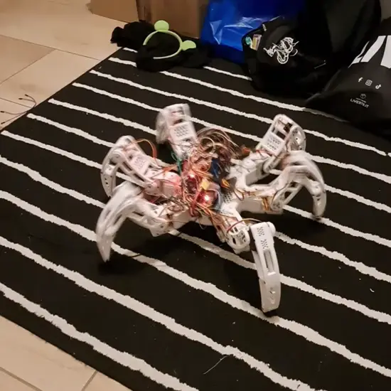

\# Hexapod


Firmware for a six-legged, 18-servo walking robot, written in C++ on an ESP32 (Arduino framework, PlatformIO). The robot is driven by a custom handheld controller over an nRF24L01 radio link. The controller firmware lives in a separate repo: \[ESP32\_RC\_Transmitter](https://github.com/gab-lap/ESP32\_RC\_Transmitter).


<p align="center">

&#x20; 

</p>


Everything in the motion chain is written from scratch: inverse kinematics, Bézier foot trajectories, gait scheduling, hierarchical state machines, and the radio receiver. The only libraries used are for the servo driver, the ESP32 servo PWM and the nRF24 radio.


\## What it does


\- Tripod gait, with stick-proportional speed, direction and turning

\- Walks in any direction (left stick) while rotating (right stick X), blended in the same step

\- Joystick input is low-pass filtered so the robot accelerates and stops smoothly instead of jerking

\- Boots asleep, toggles between sleep and walk with a stick click, and returns to sleep by itself if the radio link is lost for more than 500 ms

\- Joint limits are checked on every command, and unreachable foot targets are rejected rather than sent to the servos

\- Ripple and wave gait tables are defined (not yet selectable at runtime, see \[Status](#status))


\## Hardware


| Part | Role |

|---|---|

| ESP32 (AZ-Delivery DevKit v4) | Main controller |

| PCA9685 16-channel PWM driver (I2C, address `0x40`) | Drives 16 of the 18 servos |

| 18 hobby servos (3 per leg) | Coxa, femur, tibia joints |

| nRF24L01 | Receives the controller packets |


<!-- TODO: servo model, battery/BEC and power wiring, frame material (3D-printed? CAD link?), photo of the electronics -->


\*\*Leg geometry\*\* (from `include/config.h`): coxa 45.1 mm, femur 100 mm, tibia 174 mm. Default foot distance from the body is 170 mm, default ground distance is -100 mm.


\*\*Pin map\*\*


| Signal | GPIO |

|---|---|

| I2C SDA / SCL (PCA9685) | 21 / 22 |

| nRF24 CE / CSN | 4 / 5 |

| nRF24 SCK / MISO / MOSI | 18 / 19 / 23 |

| Back-right femur servo (direct PWM) | 25 |

| Back-right tibia servo (direct PWM) | 26 |


\*\*Servo channels\*\*


| Leg | Coxa | Femur | Tibia |

|---|---|---|---|

| Middle right | PCA 0 | PCA 1 | PCA 2 |

| Front right | PCA 3 | PCA 4 | PCA 5 |

| Front left | PCA 6 | PCA 7 | PCA 8 |

| Middle left | PCA 9 | PCA 10 | PCA 11 |

| Back left | PCA 12 | PCA 13 | PCA 14 |

| Back right | PCA 15 | GPIO 25 | GPIO 26 |


The PCA9685 only has 16 channels, so the last two servos are driven straight from ESP32 pins. Both kinds sit behind the same `VirtualServo` interface, so the leg code doesn't care which one it has.


\## Controls


The robot is meant to be used with the matching controller (two analog sticks with push buttons).


| Input | Action |

|---|---|

| Left stick | Translate (direction and speed follow the stick) |

| Right stick X | Rotate in place / while walking |

| Right stick click (J2) | Toggle sleep / walk |

| No packet for 500 ms | Robot goes back to sleep |


Over the serial monitor (115200 baud), typing a number between 0.0 and 1.5 sets the gait's speed multiplier at runtime.


\## How it works


\### Control flow


```

loop()

&#x20;└─ Robot::Update()

&#x20;    ├─ RC\_Transmitter::Update()        read nRF24, detect button edges

&#x20;    ├─ link timeout check              > 500 ms without a packet -> sleep state

&#x20;    └─ current robot state Update()

&#x20;        ├─ RobotSleepState             legs ease back to the home position

&#x20;        └─ RobotWalkState              joystick -> gait phase -> foot targets

&#x20;            └─ Leg::MoveToPosition()   inverse kinematics -> joint angles -> servos

```


\### Two layers of state machines


A small templated `StateMachine<T>` / `State<T>` pair (in `src/States/`) is used twice:


\- \*\*Robot level:\*\* `RobotSleepState` and `RobotWalkState`

\- \*\*Leg level:\*\* each `Leg` owns its own machine with sleeping, pushing, lifting and standing states, which follow the stance/swing phase of the step cycle


\### Gait generation


Each leg has a cycle phase `t` in `\[0, 1)`. A gait (`GaitData`) is a table of per-leg phase offsets plus a few parameters:


| Parameter | Meaning |

|---|---|

| `cycleOffsets\[6]` | Phase offset of each leg within the cycle |

| `pushFraction` | Fraction of the cycle spent on the ground (stance) |

| `maxStepLength`, `maxRotationLength` | Largest step the sticks can request |

| `liftHeight` | How high the foot is lifted during swing |

| `stepLengthMultiplier`, `cycleSpeedMultiplier` | Scaling for step size and cycle speed |


The tripod gait splits the legs into two groups of three (middle-right, front-left, back-left against front-right, middle-left, back-right), half a cycle apart.


The cycle advances by an amount proportional to how hard the sticks are pushed, so stick deflection controls walking speed. Foot targets come from Bézier curves:


\- \*\*Stance (foot on the ground):\*\* a straight drag from where the foot landed to the end of the step, for translation, and a separate 3-point curve for rotation

\- \*\*Swing (foot in the air):\*\* a 4-point curve for translation and a 5-point curve for rotation, lifting the foot to `liftHeight` and setting it down slightly above ground before the final touchdown


The translation and rotation foot points are blended by the relative size of the two stick inputs, which is what lets the robot walk and turn in the same motion.


\### Inverse kinematics


`src/Locomotion/InverseKinematics.cpp` converts a foot target `(x, y, z)` in the leg's frame to three joint angles with the usual two-link law-of-cosines solution plus a coxa rotation. Targets that can't be reached (the cosine terms fall outside \[-1, 1]) are rejected. Output angles are then offset for the servo horn mounting and checked against hard limits (coxa 30°-150°, tibia 0°-130°) before being written.


\### Hardware abstraction


`VirtualServo` is the interface; `DriverServo` (PCA9685) and `PinServo` (direct GPIO via ESP32Servo) implement it. Each servo has its own angle offset and min/max pulse width (default 500-2500 µs), so per-servo calibration doesn't touch the locomotion code.


\## Radio link


The robot reads a 5-byte packet from the controller:


| Byte | Content |

|---|---|

| 0-3 | `j1x`, `j1y`, `j2x`, `j2y`, each `0..254`, centre at `127` |

| 4, bit 0 | `j1b` (left stick button), `0` = pressed |

| 4, bit 1 | `j2b` (right stick button), `0` = pressed |


Radio settings: channel 110, pipe address `"00001"`, 250 kbps, low PA level. The controller sends at roughly 50 Hz. Button clicks are detected as a falling edge, so holding the button down doesn't re-trigger.


The packet struct is defined in both repos and the two \*\*must match byte for byte\*\*.


\## Build and flash


Requires \[PlatformIO](https://platformio.org/).


```bash

git clone \[https://github.com/gab-lap/Hexapod.git](https://github.com/gab-lap/Hexapod.git)

cd Hexapod

```


Before building, edit `platformio.ini`:


\- Set `upload\_port` and `monitor\_port` to your own serial port. They are currently `COM7`, which is specific to my Windows machine (the controller used `COM3`). On Linux this is typically `/dev/ttyUSB0`.


Then:


```bash

pio run -t upload

pio device monitor

```


Libraries (installed automatically by PlatformIO): `Adafruit PWM Servo Driver Library`, `ESP32Servo`, `RF24`.


On boot the robot prints status over serial and goes to sleep. Turn the controller on, click the right stick, and it stands up and starts responding.


> \*\*Linux note:\*\* this was developed on Windows, where file names aren't case-sensitive. The sources include `RC\_Receiver.h` but the file is named `RC\_receiver.h`, which fails to compile on Linux and macOS. Rename the file to `RC\_Receiver.h` or fix the includes in `main.cpp` and `RC\_receiver.cpp`.


\## Tuning


| What | Where |

|---|---|

| Overall speed cap | `globalSpeedMultiplier` in `include/config.h` |

| Gait shape and speed | `src/Core/GaitData.cpp` |

| Stick smoothing | the `0.04` / `0.06` lerp factors in `RobotWalkState.cpp` |

| Sleep/stand-up speed | the `0.02` lerp factor in `RobotSleepState.cpp` |

| Per-servo calibration | `SetMicroseconds()` and `offset` on each servo (commented examples in `main.cpp`) |

| Link-loss timeout | `isConnected()` in `RC\_receiver.h` |


\## Repository layout


```

include/

&#x20; config.h              robot dimensions, pin numbers, global speed

&#x20; models.h              leg/robot data structs, LegAngles

src/

&#x20; main.cpp              hardware setup, leg construction, main loop

&#x20; Core/                 Robot, gait data, radio receiver, vector math, utilities

&#x20; Hardware/             VirtualServo interface, PCA9685 and GPIO servo drivers

&#x20; Locomotion/           Leg class and inverse kinematics

&#x20; States/               generic state machine, robot states, leg states

```


\## Status


Working: tripod gait on hardware, translation and rotation, radio control, sleep/wake, link-loss failsafe.


Known limitations and open items:


\- Only the tripod gait is live. Ripple and wave are defined in `GaitData.cpp`, and `Robot::ChangeGait()` exists, but nothing triggers a gait change yet. `BI`, `QUAD` and `JUMP` are declared but not implemented.

\- No body height or tilt control; the body height is fixed by `distanceFromGround`.

\- The inverse kinematics uses `atan(x / y)` for the coxa angle, which is undefined at `y = 0`. `atan2` would be the right call.

\- Debug `Serial.println` calls remain in the main loop (for example while the controller is disconnected), which slows the loop when they fire.

\- No battery monitoring and no servo current limiting.

\- `platformio.ini` references a `main1.cpp` in `build\_src\_filter` that doesn't exist in the repo.


\## Used in A.T.I.D.E.


This robot is the hardware side of \[A.T.I.D.E.](https://github.com/gab-lap/A.T.I.D.E.), an agent that decides how to recover from rover faults. In the demo, the physical hexapod acts out the agent's decisions: the controller is flashed with a bridge firmware that lets a laptop send the same packets over USB, so the robot sees nothing different from a human operator. That bridge firmware is not part of this repo.


<!-- TODO: confirm the wording above and decide whether to link the demo video -->


\## License


<!-- TODO: add a LICENSE file (MIT, like A.T.I.D.E.?) and name it here -->

